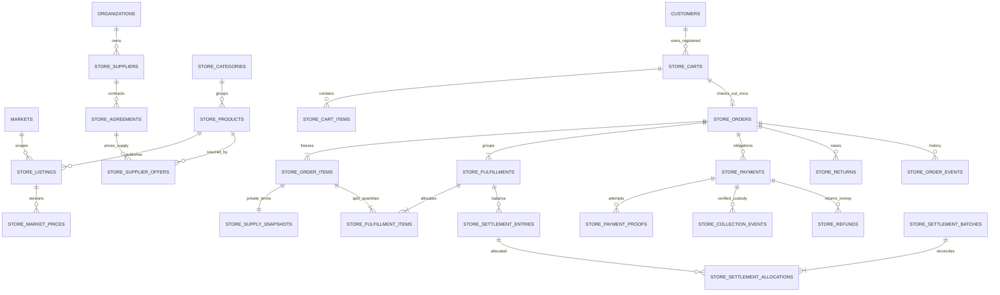

# Proposed ERD and schema specification

Conceptual specification only: **no DDL, SQL execution or migration approval**. Names are proposals, including refinements to the owner's candidate list. Do not modify the 47 existing migrations.

## Domain boundaries and keys

Reuse organization, Market, profile and registered Customer identifiers, canonical membership/permission resolution and geography identifiers where semantically valid. Do not attach Store children to existing Transport `orders`, `payments`, `invoices`, `jobs` or `trips`. Store delivery eligibility is separate from Transport `service_areas`.

Every tenant entity has `(organization_id, id)` uniqueness; Market-owned aggregates additionally have `(organization_id, market_id, id)` and monetary rows validate currency against that same Market. Composite child FKs include organization, Market and parent identity, not just a UUID. Supplier is organization-scoped; its offers and agreements are Market-scoped. Public business references are organization/Market-scoped, allocated atomically and never authorization.

V1 has exactly one fulfillment group per placed order, enforced by the placement command and a versioned V1 contract. The ERD's one-to-many capacity is deliberate future compatibility. A deferred commit-time allocation check requires every ordered unit to belong to exactly one group initially; later splits cannot duplicate quantity.

## Entity catalogue

| Proposed entity                                                        | Main fields / relations / important constraints                                                                                                                                                                       |
| ---------------------------------------------------------------------- | --------------------------------------------------------------------------------------------------------------------------------------------------------------------------------------------------------------------- |
| `store_suppliers`                                                      | Organization, legal/display identity, active/suspended, administrative contacts and revision; restricted staff data, no Auth identity/self-registration                                                               |
| `store_supplier_agreements` (refinement)                               | Supplier + Market/currency, version, effective period, fulfillment commitment, cost/discount/delivery/return/collection responsibilities, approved document reference; immutable versions and approval audit          |
| `store_categories`                                                     | Organization, parent category, localized name/slug, publication state; prevent cycles and cross-organization parenting                                                                                                |
| `store_products`                                                       | Organization, category, stable SKU, localized title/description, specifications and approved media, global suspension; one sellable SKU per product in proposed V1, no warehouse quantities                           |
| `store_product_market_listings` (refinement)                           | Product + Market, publication state, delivery-policy version, customer-safe availability message; unique product/Market                                                                                               |
| `store_supplier_offers`                                                | Product + supplier + agreement + Market/currency, supplier cost minor units, effective dates, active/revision and fulfillment-commitment mode; restricted sourcing data, not public product fields                    |
| `store_market_prices`                                                  | Listing, version, selling amount/currency, pricing/tax presentation policy reference, effective period, author; no authoritative FX, no supplier cost columns; prevent ambiguous overlapping active prices            |
| `store_carts`                                                          | Organization/Market/currency, registered Customer or gated Store guest session, OPEN/terminal state, revision/expiry, checkout contract version; exactly one ownership mechanism                                      |
| `store_cart_items`                                                     | Cart + listing, quantity, last reviewed price revision; unique cart/listing, positive bounded quantity. Cart amount is recomputed, not trusted client input                                                           |
| `store_orders`                                                         | Cart identity unique, business reference, Customer or gated guest contact owner, currency, immutable placed totals and terms/tax/delivery versions, order state/revision; one order per cart                          |
| `store_order_items`                                                    | Order, line number, SKU/title/specification snapshot, quantity, selling unit/subtotal/discount/tax/total and delivery allocations; immutable public commercial facts                                                  |
| `store_order_item_supply_terms` (private refinement)                   | One immutable supply snapshot per order line in V1: supplier, offer/agreement version, supplier unit entitlement, funded discounts/fees, calculation basis and approved tax treatment; never customer-readable        |
| `store_order_addresses` (refinement)                                   | Immutable placed recipient/contact/address and validated Market/geography snapshot; later delivery correction is a new approved operational version, not mutation of placed commercial facts                          |
| `store_fulfillments`                                                   | Order + supplier + Market/currency, state/revision, communication/delivery evidence references; supplier identity cannot be silently switched after handoff                                                           |
| `store_fulfillment_items` (refinement)                                 | Group + order item + quantity, delivery/return allocations; aggregate quantity checks enforced transactionally across concurrent groups                                                                               |
| `store_payments`                                                       | Store order obligation, currency/due amount, collection method/responsible party and revision; source method/account snapshots, separate receipt/attempt/refund facts rather than overloaded Transport payment status |
| `store_payment_proofs`                                                 | Payment attempt number, immutable destination version reference, reserved private file metadata, upload/submission/review states, reviewer/reason; unique file/attempt binding; proof alone never creates collection  |
| `store_collection_events` (refinement)                                 | Payment/group allocation, reported versus verified amount, custodian SUPPLIER/NAQL365, evidence/reconciliation reference, verification actor and linked reversal; only verified facts affect collectible balances     |
| `store_supplier_settlements`                                           | Batch header scoped to one organization/Market/currency/supplier, direction, approved amount, external execution/reconciliation and revision; no cross-supplier net balance                                           |
| `store_settlement_entries`                                             | Append-only signed balance effect per fulfillment/supplier/book, source event, effective time and reversal reference; uniqueness on source event + posting kind + group; no edit/delete of posted entries             |
| `store_settlement_allocations` (refinement)                            | Batch to eligible balance entries/group, reserved/executed allocation and amount; locked cumulative limits and release on approved pre-execution void                                                                 |
| `store_returns` and return items (refinement)                          | Order/group/line quantities, case state/reason/evidence, physical receipt and approved credits; returned quantity cannot exceed net delivered quantity                                                                |
| `store_cancellation_requests` / `store_order_adjustments` (refinement) | Customer request and staff decision are separate; immutable approved line credits/charges identify quantities, funding party, policy/tax-credit version and original snapshot; no rewrite of placed totals            |
| `store_refunds` and allocations                                        | Order/payment, return/cancellation source, approved/reserved/executed/verified amount and currency, refund payer, external reference and reversal; allocations link original verified collections and lines           |
| `store_order_events`                                                   | Append-only order/group revisions and customer-safe event facts; restricted metadata in a separate internal event/audit relation                                                                                      |
| Private command receipts                                               | Actor/authority scope, aggregate, command version, mutation key, canonical intent digest, durable result and retention; conflicting reuse denied, no secrets in digest input or result                                |
| Private Store guest sessions / resource grants (gated refinement)      | Distinct verifier-only session plus explicit cart/order resource grants, scoped actions, expiry/revocation and version; no Transport grant reuse, Auth identity bootstrap or raw secret storage                       |
| Store collection-account configuration                                 | Separate restricted Market/method/currency account versions, eligibility approvals and retirement; future only, no live values here and no mutation of Transport bank-account contracts                               |
| Store file bindings / media                                            | Public approved catalog media separate from private proofs/return/collection evidence; explicit resource-purpose binding. Reuse Storage infrastructure, not Transport proof authorization policies                    |

Additional relations are justified boundaries, not approval to build all tables at once. The eventual migration review must minimize physical entities while preserving cost isolation, immutable versions, item allocations and duplicate-execution constraints. Existing `file_objects` policies are purpose/Transport aware; a Store extension needs separately approved purpose/FK/policy design or dedicated metadata, never a blanket grant.

## Snapshot and arithmetic constraints

Selling and supply snapshots are separate security surfaces. RLS hides rows, not individual sensitive cost columns in an otherwise readable row; hiding a UI column or using an unprotected view is insufficient. Prefer private supply/agreement relations and explicit safe projections with reviewed function privileges.

Amounts use bounded integer minor units; intermediate multiplication/aggregation must detect overflow before conversion to JavaScript safe integers. Enforce nonnegative prices, bounded positive quantities, consistent line arithmetic, approved tax treatment and exact allocated order totals. Missing tax policy is unconfigured, not zero tax. Discounts/delivery/refunds require deterministic allocation (proposed largest-remainder with stable line-ID tie-break); approve the rule before implementation. Do not change Transport's rounding equations.

Versioned publication and order snapshots capture applied commercial policies, supplier agreement/cost, selling price, tax basis, delivery fee, discount bearer, collection responsibility and return terms. Referenced policy versions are immutable. Products/accounts may be suspended for future use without cascading deletion into commercial records. Retention/privacy decisions may later redact eligible PII through a controlled process while retaining necessary financial references; no retention duration is invented here.

## Indexes, uniqueness and atomicity

- Catalog: unique organization/SKU and locale slug; index listing `(organization, market, publication, category, sort, id)`. Bounded keyset search uses approved localized searchable fields and suitable PostgreSQL text/trigram indexes; Arabic normalization needs a measured prototype, not a new external service by default.
- Price/offer: indexes on organization/Market/product/supplier and effective versions; exclusion/transactional constraints prevent simultaneous conflicting current versions. Lock publication/offer versions during checkout.
- Customer history and staff queues: `(organization, market, customer, created_at DESC, id DESC)` and `(organization, market, state, created_at, id)`. Cursor includes timestamp/ID, filter context and bounded page size; no organization-wide totals manufactured by fetching all pages.
- Financial: unique attempt number per payment; normalized collection reconciliation references scoped to receiving account/provider/currency. A bank transaction allocated to multiple orders has one receipt header and bounded allocations, not duplicate receipts. Unique external refund/settlement execution reference in its appropriate source scope; application idempotency does not replace this check.
- Ledger: `(organization, market, supplier, currency, fulfillment, effective_at, id)`; unique posting source; reverse exactly once up to original amount through explicit partial-reversal allocations.
- Commands/events: unique authority scope/command/mutation key and aggregate/revision; all authorization, snapshot, financial postings, audit events and command outcome commit together. Files and external transfers are multi-step workflows with durable reservation/reconciliation, never assumed atomic with Postgres.

For a future populated upgrade, add separate Store data without backfilling/reclassifying any Transport commercial row or role grant. No Store price, account, tax, supplier, catalog publication or live Market activation should be silently seeded by a schema migration.
